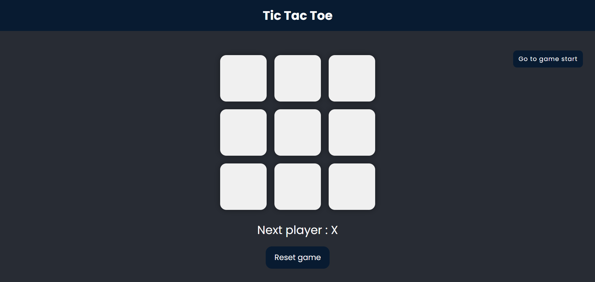

# 🎮 Tic Tac Toe Game


A clean and interactive **Tic Tac Toe** game built using **React**. <br />
This project is my first hands-on React application, inspired by the official **React.dev** tutorial. I previously built this game using **vanilla JavaScript**, and recreating it in React helped me understand component structure, props, state management, and time-travel debugging.

---

## 📸 Screenshots



---

## 🌐 Live Demo

Check out the live version of the project here: [Tic Tac Toe Game](https://tic-tac-toe-react-mu-rust.vercel.app/)

---

## ✨ Features

| Feature | Description |
|:---|:---|
| **Classic Tic Tac Toe Gameplay** | Enjoy the traditional two-player Tic Tac Toe experience. |
| **Modular React Components** | Built with reusable and modular React components for better code organization. |
| **Fully Responsive Design** | Optimized for a seamless experience across different devices and screen sizes. |
| **Restart & New Game** | Restart the current match or start a fresh game at any time. |
| **Time Travel** | Navigate through the history of moves to revisit previous game states. |
| **Winner & Game Status Highlights** | Visually highlights the winning combination and ended game states. |

---

## 🛠️ Technologies Used

| Technology | Purpose |
|:---|:---|
| **React.js** | Builds the user interface using reusable components and manages game state. |
| **HTML5** | Provides the structure of the application. |
| **CSS3** | Handles styling, layout, and responsive design using plain CSS. |

---

## 🛠️ Installation

1️⃣ Clone the repository

```bash
git clone https://github.com/TonyStark-19/Tic-Tac-Toe-React.git
```

2️⃣ Move into the project directory

```bash
cd Tic-Tac-Toe-React
```

3️⃣ Install dependencies

```bash
npm install
```

4️⃣ Start the development server

```bash
npm start
```

The app will be running on `http://localhost:3000`

---

## 🎮 How to Play

| Step | Instructions |
|:---:|:---|
| **1** | Visit the game: [Play Tic Tac Toe](https://tic-tac-toe-react-mu-rust.vercel.app/). |
| **2** | Player **X** starts the game. |
| **3** | Players take turns selecting cells on the 3×3 game board. |
| **4** | Get three marks in a row (horizontally, vertically, or diagonally) to win. |
| **5** | If all cells are filled and no player wins, the match ends in a draw. |
| **6** | Click the **Restart** button to start a fresh game. |
| **7** | Use **Time Travel** to revisit any previous move in the game history. |

---

## 📌 What I Learned

- Managing UI using React components
- Using state to track gameplay
- Implementing immutable updates
- Rendering lists dynamically
- Managing time travel using stored history
- Understanding React’s core concepts more deeply

---

## 🤝 Contribution

Feel free to fork this repository and contribute to enhance the project. 😊

---

💙 Acknowledgements

Inspired by the official [React documentation](https://react.dev/learn) tutorial
Deployed using Vercel

---

Made with ❤️ by **Aditya Chandel**
